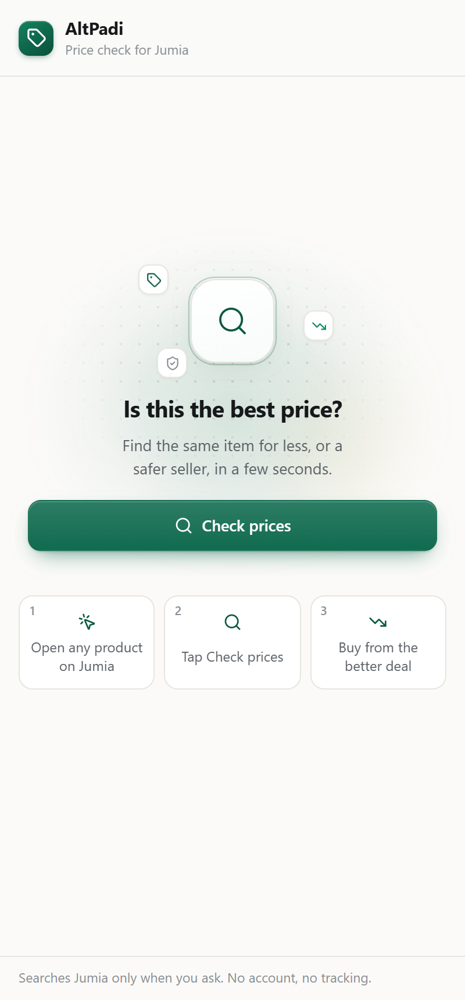
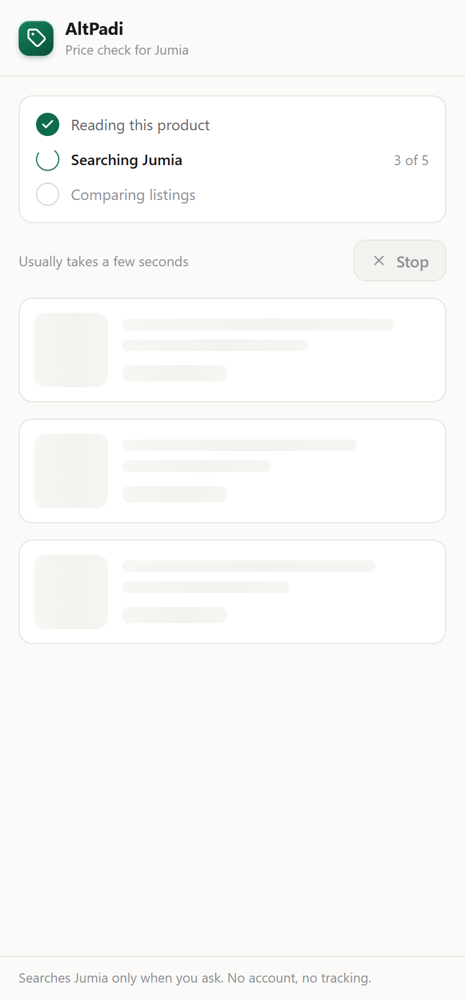
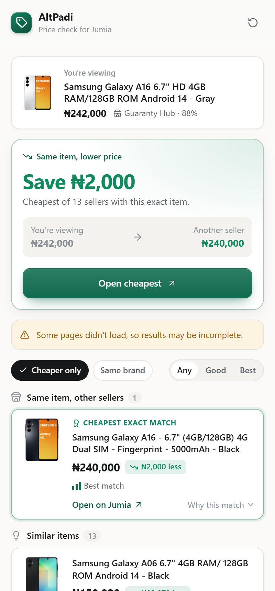
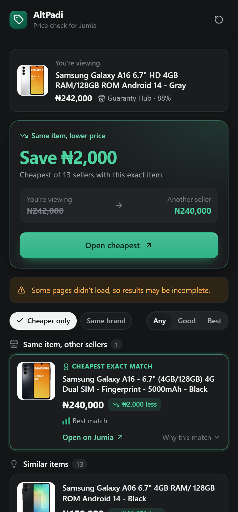

<p align="center">
  
</p>

<h1 align="center">AltPadi</h1>

<p align="center">
  <b>Is this the best price on Jumia?</b><br />
  A Chrome side panel that checks other sellers of the same item in a few seconds,
  and tells you plainly whether you can pay less.
</p>

<p align="center">
  
  
  
</p>

<p align="center"><sub>Real Jumia Nigeria listings, rendered by the extension's own side panel.</sub></p>

## What it does

1. **Open any product on [jumia.com.ng](https://www.jumia.com.ng).**
2. **Tap Check prices** in the AltPadi side panel.
3. **Get one clear answer:** "Save ₦X" with the cheapest seller of the exact same item, or
   "You already have the lowest price", plus a better-rated seller at the same price when there is one.

Below the answer, results are grouped so you never mistake a phone case for a phone:

| Group | What's in it |
|---|---|
| Same item, other sellers | Same model and configuration, cheapest first |
| Other sizes & versions | Same product, different storage, size or pack |
| Similar items | Comparable products from other brands |
| Accessories & parts | Made for this item, not the item itself (folded away) |
| Hidden: looks too cheap | Same name at an implausible price: often a fake, a part, or bait (folded away) |

Each card shows four things: name, price, how much you save, and the seller's score.
"Why this match" reveals the reasoning (same brand, similar specs, trusted seller…).

<p align="center">
  
  <br /><sub>Follows your system's dark mode.</sub>
</p>

## Privacy

- Nothing runs until you press **Check prices**. No background scraping.
- No account, no analytics, no backend, no remote code. It only talks to jumia.com.ng.
- The "savings found" tally lives in your browser's local storage and never leaves it.

## Install (developer mode)

```bash
npm install
npm run build
```

Then in Chrome: **Extensions → Developer mode → Load unpacked →** choose the `dist` folder.
Pin AltPadi from the puzzle icon so it's one click away.

## Development

```bash
npm test            # unit + component tests (Vitest, Testing Library)
npm run typecheck
npm run lint
npm run test:browser  # loads the built extension in Chromium (Playwright)
```

### How the code is organised

```
src/
  core/            Pure matching logic: identity, scoring, price/quantity parsing, search runner
  marketplaces/    One adapter per store (jumia-ng today), isolated behind MarketplaceAdapter
  extension/       Background worker, content script, message types
  ui/
    model/         Pure view logic: filters, verdict, progress steps, error wording, savings tally
    hooks/         useSearch (state machine with stop), useSavings, usePinTip, useCountUp
    components/    One small component per file; SidePanel.tsx composes them
```

The search runner reports progress (`reading → searching n of m → comparing`), which the
background worker forwards to the side panel, so the panel shows real steps instead of a busy cursor.

### Regenerating assets

```bash
node scripts/build-icons.mjs                                   # toolbar icons from the logo
npx vite-node scripts/screenshots/capture-run.ts "samsung galaxy a16"   # live Jumia run -> run.json
npx vite --port 5199 & node scripts/screenshots/shoot.mjs       # README screenshots
```

`design/ui-proposal.html` is the interactive design reference the side panel was built from.
